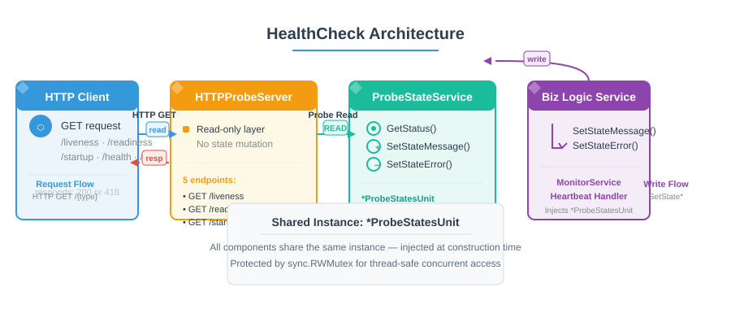

# bc-wallet-common-lib-healthcheck

## Description

Go library for managing Kubernetes-style HTTP healthcheck probes. Provides **five independent probes** — each runs on its own HTTP server with configurable port, path, timeouts, listen address, and enable/disable flag:

| Probe       | Default Port | Default Path | Purpose |
|-------------|-------------|--------------|---------|
| Startup     | 8202        | `/startup`   | Verifies the application has finished initializing before accepting traffic |
| Readiness   | 8201        | `/readiness` | Determines whether the service can accept traffic (used by load balancers) |
| Liveness    | 8200        | `/liveness`  | Detects if the process is frozen or stuck; signals Kubernetes to restart |
| Health      | 8080        | `/health`    | Aggregates the overall health of all registered internal components |
| Ping        | 8202        | `/ping`      | Lightweight connectivity check (returns `pong`) |

Each probe can be enabled or disabled independently through environment variables.

---

## Architecture

### Three-layer separation

The healthcheck system follows a strict architectural boundary: each layer owns a single responsibility and interacts with adjacent layers through well-defined interfaces.

### HTTPCheckerAPI — Read-only HTTP Layer

Serves incoming HTTP requests for all five probe endpoints. Never writes state — every request calls [ProbeStatesUnit.GetStatus()] internally to read the latest snapshot and returns HTTP 200 or 418. Public methods are defined on the type returned by [NewHTTPHealthChecker]:

| Method | Description |
|---|---|
| `AddLivenessProbeChecker(cfg, statesSvc)` | Register liveness probe (auto-enabled when `PROBE_LIVENESS_ENABLED=true`) |
| `AddRedinessProbeUnit(cfg, statesSvc)` | Register readiness probe handler |
| `AddStartupProbeUnit(cfg, statesSvc)` | Register startup probe handler |
| `ListenAndServe(ctx)` | Launches all registered probe servers as goroutines; blocks until ctx is cancelled |

Each registration receives a config implementing `probeCheckerConfigService` and a state store implementing `probeStatesService`.

### ProbeStateService — State Storage

[ProbeStatesUnit] stores per-unit results in thread-safe maps (`sync.RWMutex`). Provides two categories of operations:

| Category | Methods | Direction |
|---|---|---|
| Writes | `SetStateMessage(name, message)`, `SetStateError(name, err)` | ← called by BusinessLogicService |
| Reads | `GetStatus()`, `GetState(name)`, `GetStates()`, `GetStatesByNames(...)` | → called by HTTPCheckerAPI |

It does not know about HTTP. It neither serves requests nor understands business logic.

### BusinessLogicService — External State Manager

Any component that monitors internal dependencies (e.g., `MonitorServiceComponent`, heartbeat handlers) implements this role. It receives a `*ProbeStatesUnit` injected at construction time and updates probe statuses through the public write methods above. The healthcheck layer has no knowledge of which specific services exist — it only interacts through the interfaces documented in HTTPCheckerAPI and ProbeStateService.



[View PUML source](./doc/architecture.puml)

Data flows unidirectionally left-to-right for requests (**HTTPClient → HTTPProbeServer → ProbeStateService**),
and right-to-left for writes (**BusinessLogicService → ProbeStateService**). Every probe response leaves
back to the **HTTPClient** via the same endpoint the request entered on.

This separation keeps the healthcheck library decoupled from business logic. Probes report only the state recorded by whatever monitor owns that component.

---

## Exported Components

### ProbesConfig — Unified Config Aggregator

Aggregates all five probe configurations into a single struct. All sub-configs are nil-safe — accessing a missing sub-config returns safe defaults.

```go
NewProbesConfig() *ProbesConfig
```

**Methods:**
- `IsLivenessProbeEnable() bool` / `GetLivenessListenAddress() string`
- `IsReadinessProbeEnable() bool` / `GetReadinessListenAddress() string`
- `IsStartupProbeEnable() bool` / `GetStartupListenAddress() string`
- `IsHealthcheckProbeEnable() bool` / `GetHealthcheckListenAddress() string`
- `IsPongProbeEnable() bool` / `GetPingListenAddress() string`
- Per-probe getters: `Get{Probe}ProbeRequestPath()`, `Get{Probe}ProbeReadTimeout()`, `Get{Probe}ProbeWriteTimeout()`, `Get{Probe}ProbeListenPort()`

### HTTP Config Structs — Per-Probe Settings

| Type              | Description                          |
|-------------------|--------------------------------------|
| `LivenessHTTPConfig`   | Liveness probe settings (port, path, timeouts, enabled flag) |
| `ReadinessHTTPConfig`  | Readiness probe settings             |
| `StartupHTTPConfig`    | Startup probe settings               |
| `HealthcheckHTTPConfig`| General health endpoint settings     |
| `PingProbeHTTPConfig`  | Ping/pong connectivity check settings|

Each struct exposes `Is{Probe}ProbeEnable()` and typed getters for port, path, read/write timeouts, and listen address. They embed `probeCheckerConfigService` interface methods (`GetListenAddress()`, `GetHTTPReadTimeout()`, `GetHTTPWriteTimeout()`, `GetRequestURL()`, `GetProbeName()`).

### NewHTTPHealthChecker — Coordinator Factory

Constructs the healthcheck coordinator that manages all probe HTTP servers. Returns a pointer to the internal checker type whose public methods control probe lifecycle.

```go
func NewHTTPHealthChecker(
    errFmtSvc errorFormatterService,
    log *log.Logger,
    cfgSvc configService,
) *httpHealthChecker
```

### httpHealthChecker — Probe Lifecycle Methods

Public receiver methods on the checker returned by `NewHTTPHealthChecker`:

| Method                              | Description |
|-------------------------------------|-------------|
| `AddLivenessProbeChecker(cfg, statesSvc)` | Register liveness probe handler (auto-enabled when `PROBE_LIVENESS_ENABLED=true`) |
| `AddRedinessProbeUnit(cfg, statesSvc)`    | Register readiness probe handler |
| `AddStartupProbeUnit(cfg, statesSvc)`     | Register startup probe handler |
| `ListenAndServe(ctx context.Context) error` | Launches all registered probe servers as goroutines; blocks until ctx is cancelled |

Parameters:
- `cfg` — implements `probeCheckerConfigService` (provides listen addr, timeouts, request URL, probe name)
- `statesSvc` — implements `probeStatesService` (mutable state store written by external callers)

### ProbeStatesUnit — Thread-Safe State Store

Shared state container for recording probe results. Written by external services, read-only from the HTTP layer. Supports concurrent access under `sync.RWMutex`.

```go
NewProbeStateUnit(fields ...string) *ProbeStatesUnit
```

**Methods:**
- `SetStateMessage(name, message string)` — records a successful state with a human-readable message
- `SetStateError(name string, err error)` — records a failed state with an error and extracted code
- `GetStatus() *ProbeUnitStatusReport` — returns current aggregated status (recalculates health on each call)
- `GetState(name string) *ProbeUnitResult` — returns a copy of a single unit's result
- `GetStates() map[string]ProbeUnitResult` — returns copies of all unit results
- `GetStatesByNames(names ...string) map[string]ProbeUnitResult` — returns copies filtered by names

### ProbeUnitStatusReport — Aggregated Status Response

Top-level JSON response body returned by all five probes. Always serialised via easyjson.

```go
type ProbeUnitStatusReport struct {
    Status string                        // "ok" or "probe_failed"
    Code   int                           // aggregate error code
    States map[string]*ProbeUnitResult // per-unit results keyed by name
}
```

### ProbeUnitResult — Individual Unit Result

Represents one monitored component within a probe.

```go
type ProbeUnitResult struct {
    Name    string `json:"name"`
    Message string `json:"message"`
    Code    int    `json:"code"`
}
```

- `Clone() *ProbeUnitResult` — returns a shallow copy preserving the internal `err` field
- `IsHealthy() bool` — returns true when no error occurred

---

## Getting Started

```go
import (
    "context"
    "log"
    "time"

    hc "github.com/crypto-bundle/bc-wallet-common-lib-healthcheck/pkg/healthcheck"
)

// 1. Create config from environment variables
cfg := hc.NewProbesConfig()
_ = envconfig.Process("", cfg)

// 2. Create state containers (one per external monitor)
dbStates   := hc.NewProbeStateUnit("db")
cacheStates := hc.NewProbeStateUnit("cache")

// 3. Build coordinator
checker := hc.NewHTTPHealthChecker(errSvc, log.Default(), cfg)

// 4. Register probes
livenessCfg := &hc.LivenessHTTPConfig{}
readinessCfg := &hc.ReadinessHTTPConfig{}
startupCfg := &hc.StartupHTTPConfig{}

checker.AddLivenessProbeChecker(livenessCfg, dbStates)
checker.AddRedinessProbeUnit(readinessCfg, cacheStates)
checker.AddStartupProbeUnit(startupCfg, dbStates)

// 5. Start servers (non-blocking)
ctx := context.Background()
go func() {
    if err := checker.ListenAndServe(ctx); err != nil {
        log.Printf("healthcheck stopped: %v", err)
    }
}()

// 6. Write state from your service components
dbStates.SetStateMessage("primary", "connected")
// or on failure
dbStates.SetStateError("primary", someErr)
```

---

## Configuration

Per-probe settings use `envconfig` struct tags for injection from environment variables.

| Variable                    | Default   | Description                       |
|-----------------------------|-----------|-----------------------------------|
| `PROBE_LIVENESS_ENABLED`         | `true`   | Enable/disable liveness probe           |
| `PROBE_LIVENESS_HTTP_PORT`       | `8200`   | Listen port                             |
| `PROBE_LIVENESS_HTTP_PATH`       | `/liveness` | HTTP endpoint path                  |
| `PROBE_LIVENESS_HTTP_READ_TIMEOUT`  | `5s`  | HTTP read timeout                     |
| `PROBE_LIVENESS_HTTP_WRITE_TIMEOUT` | `10s` | HTTP write timeout                    |
| `PROBE_READINESS_ENABLED`        | `true` | Enable/disable readiness probe          |
| `PROBE_READINESS_HTTP_PORT`      | `8201` | Listen port                             |
| `PROBE_READINESS_HTTP_PATH`      | `/readiness` | HTTP endpoint path                |
| `PROBE_READINESS_HTTP_READ_TIMEOUT`  | `5s` | HTTP read timeout                       |
| `PROBE_READINESS_HTTP_WRITE_TIMEOUT` | `10s` | HTTP write timeout                      |
| `PROBE_STARTUP_ENABLED`          | `true` | Enable/disable startup probe            |
| `PROBE_STARTUP_HTTP_PORT`        | `8202` | Listen port                             |
| `PROBE_STARTUP_HTTP_PATH`        | `/startup` | HTTP endpoint path                  |
| `PROBE_STARTUP_HTTP_READ_TIMEOUT`  | `5s` | HTTP read timeout                       |
| `PROBE_STARTUP_HTTP_WRITE_TIMEOUT` | `10s` | HTTP write timeout                      |
| `PROBE_HEALTHCHECK_ENABLED`      | `true` | Enable/disable health endpoint          |
| `PROBE_HEALTHCHECK_PORT`         | `8080` | Listen port                             |
| `PROBE_HEALTHCHECK_PATH`         | `/health` | HTTP endpoint path                   |
| `PROBE_HEALTHCHECK_READ_TIMEOUT`  | `5s` | HTTP read timeout                       |
| `PROBE_HEALTHCHECK_WRITE_TIMEOUT` | `10s` | HTTP write timeout                      |
| `PROBE_PING_ENABLED`             | `true` | Enable/disable ping endpoint            |
| `PROBE_PING_HTTP_PORT`           | `8202` | Listen port                             |
| `PROBE_PING_HTTP_PATH`           | `/ping` | HTTP endpoint path                      |
| `PROBE_PING_HTTP_READ_TIMEOUT`    | `5s` | HTTP read timeout                       |
| `PROBE_PING_HTTP_WRITE_TIMEOUT`   | `10s` | HTTP write timeout                      |

---

## Response Semantics

All five probes return the same JSON structure; only the HTTP status differs:

| Status | Meaning |
|--------|---------|
| `200 OK` | All required units are healthy |
| `418` | Any required unit reports failure or is unreachable |

Example response:
```json
{
  "status": "ok",
  "code": 0,
  "states": {
    "db_primary": {
      "name": "db_primary",
      "message": "connected",
      "code": 0
    },
    "cache": {
      "name": "cache",
      "message": "reachable",
      "code": 0
    }
  }
}
```

A `418` status enables load-balancer dashboards and monitoring tools to distinguish health failures from other server errors.

---

## Errors

Registration functions return structured errors:
- ErrProbeTypeNotEnabled — the probe is disabled in configuration
- ErrProbeAlreadySettled — a probe for this index is already registered

---

## Testing

Run tests locally:
```bash
make test
```

Run tests inside Docker:
```bash
make test-docker
```

---

## Contributors

* Author and maintainer — [@gudron (Alex V Kotelnikov)](https://github.com/gudron)

## Licence

**bc-wallet-common-lib-healthcheck** is licensed under the [MIT NON-AI](./LICENSE) License. Key restrictions:

1. The Software may not be used to train or improve machine learning algorithms (including NLP, data mining, AI)
2. The Software may not be included in any ML training dataset
3. Violations are subject to legal action
